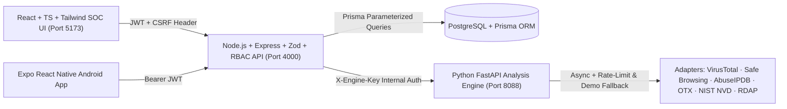

# THREATLENS AI — Cybersecurity Investigation & Threat Intelligence Platform

> **Tagline:** *"Detect threats. Investigate evidence. Understand risks. Protect systems."*

**THREATLENS AI** is a full-stack, defensive Security Operations Center (SOC) investigation and threat intelligence platform built with **React + TypeScript + Tailwind CSS**, **Node.js + Express + Prisma + PostgreSQL**, **Python + FastAPI**, and an **Expo React Native Android companion app**.

It enables security analysts to investigate suspicious **URLs, domains, IP addresses, email headers/payloads, and software vulnerabilities (CVEs)** — correlating external intelligence feeds, calculating **explainable 0–100 risk scores**, mapping indicators to **MITRE ATT&CK**, managing **Investigations & NIST SP 800-61 Incidents**, visualizing **Threat Relationship Graphs**, and exporting formal **Executive & Compliance Reports**.

---

## System Architecture



---

## Monorepo Folder Structure

```text
THREATLENS-AI/
├── frontend/                  # React 18 + TypeScript + Tailwind CSS + Recharts + Lucide (15 SOC Pages)
├── backend/                   # Node.js + Express + TypeScript + Prisma + Zod + Helmet + RBAC + Vitest
│   ├── prisma/
│   │   ├── schema.prisma      # Relational schema (Users, Indicators, Scans, Evidence, Cases, Incidents, Graph, Reports, Audit)
│   │   └── seed.ts            # Realistic, clearly-labelled [DEMO] SOC telemetry seed
│   └── src/
├── analysis-engine/           # Python 3.11 + FastAPI Threat Analysis & Explainable Risk Scoring Engine
│   ├── app/
│   │   ├── adapters/          # VirusTotal, Google Safe Browsing, AbuseIPDB, AlienVault OTX, NIST NVD, RDAP
│   │   ├── analyzers/         # URL, Email (SPF/DKIM/DMARC/BEC), IP, Domain (RDAP/DGA), CVE
│   │   ├── ai/                # AI Investigation Copilot (OpenAI-compatible + deterministic SOC Copilot)
│   │   ├── scoring/           # Explainable 0-100 Risk Scoring & MITRE ATT&CK mapper
│   │   └── security/          # SSRF Private/Loopback/Metadata IP & Scheme Guard
│   └── tests/                 # Pytest suite
├── mobile/                    # React Native + Expo Android SOC Companion App reusing backend APIs
├── docs/
│   └── STAGE_BY_STAGE_MENTOR_GUIDE.md   # Beginner-friendly English + Hinglish learning & troubleshooting guide
├── scripts/
│   ├── setup-local-pg.sh      # Zero-root local PostgreSQL bootstrap
│   ├── dev.sh                 # One-command full-stack launcher
│   └── test-all.sh            # End-to-end build & automated test runner
└── docker-compose.yml         # Containerized multi-service deployment
```

---

## Key Capabilities & All 15 Main Pages

1. **Landing Page (`/`)** — Platform vision, 6-provider intelligence architecture, and OWASP Top 10 defensive posture.
2. **Authentication (`/login`, `/register`)** — Bcrypt-12 credential security, Zod validation, and 1-click Demo RBAC quick login.
3. **Security Dashboard (`/dashboard`)** — SOC KPIs, Recharts 7-day detection velocity, IOC modality split, provider health strip, recent scans, and active incidents.
4. **URL Scanner (`/scanner/url`)** — Lexical phishing heuristics, Punycode/TLD/lure inspection, VT, Safe Browsing, OTX, and RDAP correlation.
5. **Email Threat Analyzer (`/scanner/email`)** — RFC SPF/DKIM/DMARC parser, `From` vs `Reply-To` spoofing detection, BEC urgency cues, and embedded URL/attachment checks.
6. **IP Intelligence (`/intel/ip`)** — Public IP validation, AbuseIPDB confidence, VirusTotal, OTX pulses, RIR RDAP allocation, and PTR reverse DNS.
7. **Domain Intelligence (`/intel/domain`)** — Newly Registered Domain (NRD) check via RDAP, Shannon entropy DGA detection, brand typosquatting, and DNS resolution.
8. **Vulnerability Intelligence (`/intel/cve`)** — NIST NVD v2.0 lookup, CVSS v3.1 vector breakdown, CISA KEV status, and remediation guidance.
9. **AI Investigation Assistant (`/assistant`)** — Interactive SOC Copilot with active Investigation/Scan context, MITRE ATT&CK mapping, and defensive guardrails.
10. **Investigations (`/investigations`)** — Structured case management (`INV-2026-xxx`), linked scans, analyst/AI notes timeline, and 1-click incident escalation.
11. **Incident Management (`/incidents`)** — NIST SP 800-61 lifecycle progression (`DETECTED` → `RESOLVED`) with interactive containment playbook checklists.
12. **Threat Relationship Graph (`/graph`)** — Interactive SVG node-link graph connecting Campaigns, Emails, URLs, Domains, IPs, CVEs, and Assets.
13. **Reports (`/reports`)** — Executive, Technical, and Compliance report compiler with Markdown download and Print/PDF export.
14. **Settings (`/settings`)** — Profile management, password rotation, and server-side threat feed status inspection.
15. **Admin Governance (`/admin`)** — `ADMIN`-restricted user role/status management, OWASP security control verification, and immutable **Audit Logs**.

---

## Quick Start

### Option A: One-Command Local Startup
```bash
chmod +x scripts/*.sh
./scripts/dev.sh
```
Open **http://localhost:5173** in your browser.

### Option B: Docker Compose
```bash
docker compose up --build
```

### Demo Portfolio Credentials (Seeded via `npm run prisma:seed` in `backend/`)

| Role | Email | Password | Permissions |
| :--- | :--- | :--- | :--- |
| **ADMIN** | _(created privately — not published)_ | _n/a_ | Full Scans, Cases, Incidents, Reports, User RBAC & Audit Logs |
| **ANALYST** | `analyst@threatlens.demo` | `Analyst@12345` | Full Scans, Investigations, Incidents, Graph & Reports |
| **VIEWER** | `viewer@threatlens.demo` | `Viewer@12345` | Read-only SOC Dashboard, Cases, Incidents & Compliance Reports |

> **Note on Intelligence API Keys:** THREATLENS AI works **100% out of the box** using live public keyless endpoints (`NIST NVD`, `IANA RDAP`) plus clearly labelled **`[DEMO TELEMETRY]`** fallback adapters. To activate live commercial vendor queries, add optional keys (`VIRUSTOTAL_API_KEY`, `GOOGLE_SAFE_BROWSING_API_KEY`, `ABUSEIPDB_API_KEY`, `ALIENVAULT_OTX_API_KEY`, `NVD_API_KEY`, `AI_API_KEY`) in `analysis-engine/.env`. Keys are **never** exposed to the frontend.

---

## Defensive Security & Authorized Use Notice

THREATLENS AI implements **OWASP Top 10** defensive practices:
- **Broken Access Control:** Enforced JWT + RBAC (`ADMIN`, `ANALYST`, `VIEWER`) + immutable `AuditLog` tracking.
- **Cryptographic Failures:** `bcryptjs` (cost factor 12) password hashing and server-only secret storage.
- **Injection & XSS:** Parameterized Prisma ORM queries, strict Zod input schemas, Helmet CSP headers, and script-tag sanitization.
- **CSRF & Brute-Force:** Custom `X-ThreatLens-Client` header check on cookie mutations and tiered `express-rate-limit` policies.
- **SSRF Prevention:** Strict blocking of `localhost`, `127.0.0.0/8`, RFC1918 private networks (`10/8`, `172.16/12`, `192.168/16`), cloud metadata (`169.254.169.254`), and non-HTTP(S) schemes.

**Authorized Scope Only:** This platform performs passive threat intelligence correlation and header/lexical forensics for defensive security operations and educational labs. It does **not** perform unauthorized active exploitation or intrusive scanning.
